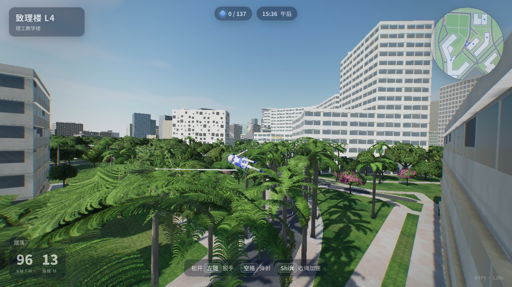
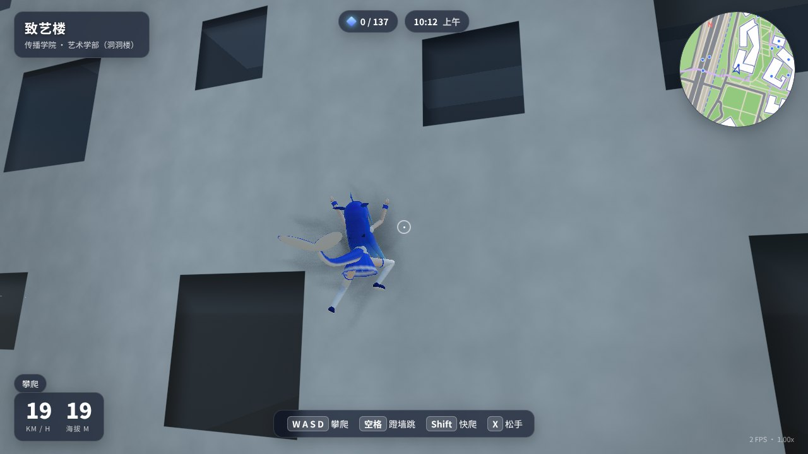
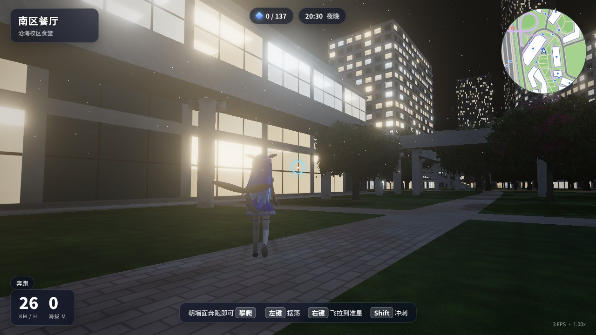
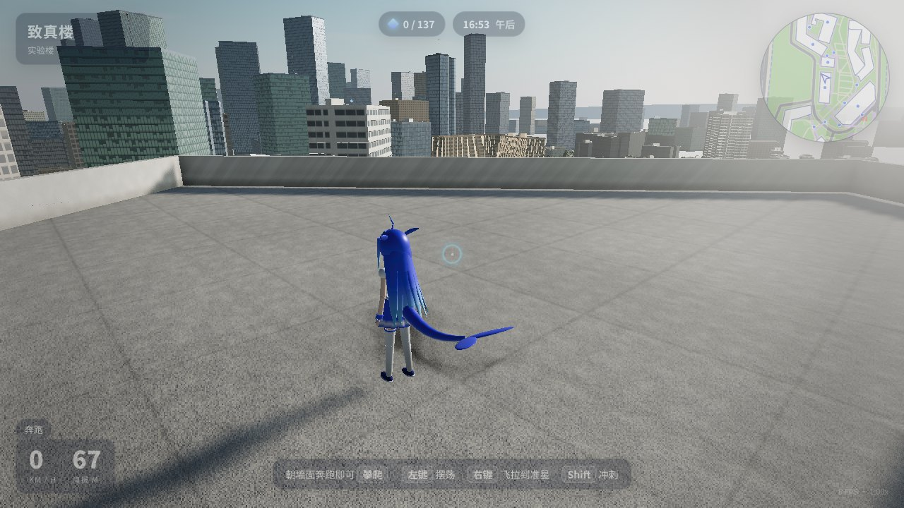

# 沧海鲸游 · Whale Swing

一个单文件 HTML 的 3D 第三人称游戏：操控 **DeepSeek 鲸鱼娘**，在按真实地图数据还原的**深圳大学沧海校区**里奔跑、攀爬建筑、用蛛丝在楼宇之间摆荡。

**直接用浏览器打开 [`index.html`](index.html) 即可游玩**（无需服务器、无需联网，推荐桌面版 Chrome / Edge / Firefox + 独立显卡）。

| | |
| --- | --- |
|  |  |
|  |  |

（以上截图由无显卡的软件渲染器在较低画质预设下离线截取，实机画面更清晰流畅。）

## 操作

| 按键 | 动作 |
| --- | --- |
| `W A S D` | 移动；贴墙时为攀爬 |
| 鼠标 | 视角（点击画面锁定鼠标） |
| `空格` | 跳跃 · 空中二段跳（鲸跃）· 墙上蹬墙跳 · 摆荡中弹射脱手 |
| `Shift` | 冲刺 · 快速攀爬 · 摆荡时收绳加速 |
| 鼠标左键（按住）/ `Q` | 发射蛛丝摆荡，松开即脱手 |
| 鼠标右键 / `E` | 飞拉：把自己拉到准星所指的墙面或楼顶 |
| `X` | 攀爬时松手下落 |
| `T` | 切换时间（清晨 / 上午 / 正午 / 午后 / 黄昏 / 夜晚） |
| `M` | 全图 |
| `R` | 回到致远门 |
| `Esc` | 暂停：画质、时间、昼夜流转、传送到各教学楼 |

首次启动会按显卡型号自动选择画质（流畅 / 均衡 / 高 / 极致），帧率不足时还会自动降低渲染分辨率；可随时在暂停菜单里改。

玩法提示：

- 朝墙面奔跑会自动攀上去，爬到楼顶边缘会翻上天台；矮墙、栏杆会自动翻越。
- 蛛丝是真实的摆锤约束：绳长固定、可松弛，下摆时加速、上摆时松手能甩得更远。准星指着哪里就优先挂哪里，否则自动在前方上空找建筑、连廊或树冠。
- 校园上空和各栋楼顶散落着 137 枚 Token，把它们都吃掉。

## 场景还原

- **地图**：建筑轮廓、道路、连廊天桥、球场、绿地、水体全部来自 OpenStreetMap 的沧海校区及周边数据（`tools/osm/`），用 `tools/process_osm.py` 转成游戏坐标（1 单位 = 1 米）。校内楼宇采用 2019 年校方命名方案：致腾楼、致信楼、致原楼、致工楼、致知楼、致理楼 L1–L4、致真楼、致艺楼（"洞洞楼"）、南区餐厅，以及春笛、夏筝、秋瑟、冬筑等学生公寓；还有致远门、召南天桥、白石路和对面的粤海校区一角。
- **建筑**：按真实层数拉伸；外立面由着色器程序化生成（带形窗、竖向格栅、玻璃幕墙、洞洞楼的随机方洞、宿舍阳台……），窗内有视差"假房间"，夜晚随机亮灯。
- **光影**：物理天空（大气散射 + 程序化云）驱动太阳方向与颜色，4 级级联阴影，天空烘焙的环境反射（PMREM），GTAO 环境光遮蔽，HDR 泛光，ACES 色调映射，距离雾；昼夜可调，夜间路灯、亮窗、车灯、航空障碍灯。
- **植被**：5400 余棵实例化的榕树、荔枝树、大王椰、簕杜鹃，叶片卡片 + 风摆动 + 三级 LOD。
- **主角**：DeepSeek 鲸鱼娘完全程序化建模（蓝色渐变长发、呆毛、头鳍、鲸尾、蓝白水手服），程序化骨骼动画（跑、跳、攀爬、摆荡、飞拉），头发与尾巴带惯性摆动。
- **声音**：全部由 Web Audio 实时合成（风声、蛛丝、脚步、鸟鸣、虫鸣）。

## 从源码构建

```bash
npm install
```

```bash
python3 tools/process_osm.py
```

```bash
node tools/build.mjs
```

`process_osm.py` 需要 `pip install shapely`，仅在想重新生成 `src/data/campus.json` 时才需要运行。`build.mjs` 用 esbuild 把 `src/`、three.js、three-mesh-bvh 和地图数据打包进单个 `index.html`。

| 路径 | 内容 |
| --- | --- |
| `src/world.js` | 建筑、地面、连廊、球场、道路标线、校门、远景天际线、碰撞体 |
| `src/materials.js` | 程序化着色器（外立面、地面、水、树叶…） |
| `src/sky.js` `src/post.js` | 天空 / 日照 / 级联阴影 / 环境光，HDR 后处理管线 |
| `src/vegetation.js` `src/props.js` | 树木；路灯、标识、车流、球门篮架 |
| `src/character.js` | 鲸鱼娘模型与动画 |
| `src/player.js` | 胶囊体碰撞、奔跑 / 攀爬 / 摆荡 / 飞拉、第三人称相机 |
| `src/main.js` | 启动、输入、HUD、小地图、Token、菜单 |

## 致谢与声明

- 地图数据 © [OpenStreetMap](https://www.openstreetmap.org/copyright) contributors，依据 ODbL 授权。
- 渲染使用 [three.js](https://threejs.org/)，碰撞检测使用 [three-mesh-bvh](https://github.com/gkjohnson/three-mesh-bvh)（均为 MIT 许可）。
- "鲸鱼娘"是网友对 DeepSeek 鲸鱼标志的二次创作拟人形象；本作为非官方同人作品，与 DeepSeek、深圳大学均无官方关联。建筑外观为依据公开资料的程序化近似，并非测绘级模型。
